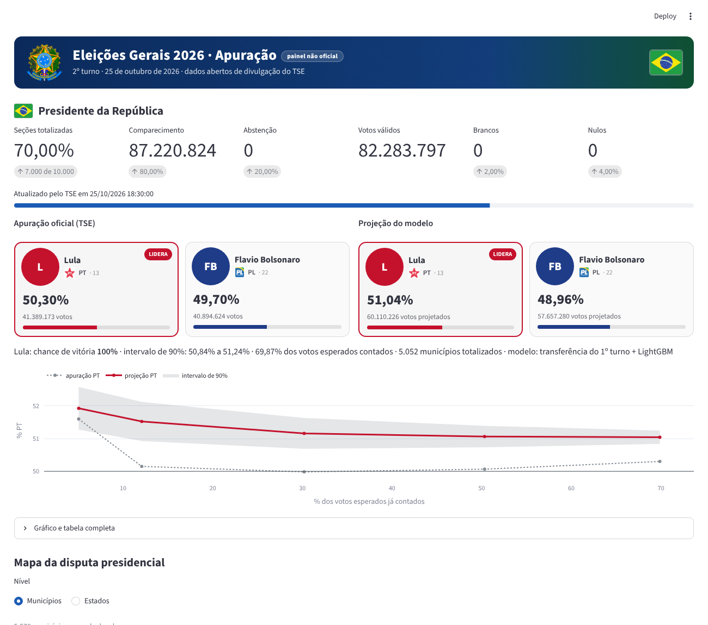
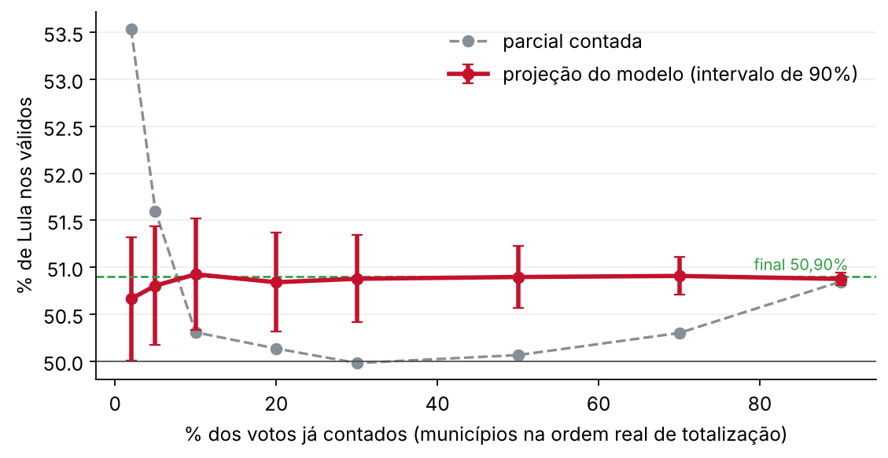
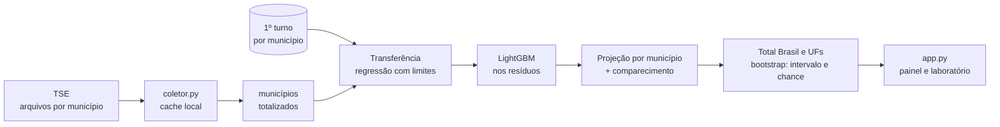

<p align="center">
  
</p>

<h1 align="center">Apuração Eleições 2026</h1>

<p align="center">
  <b>Painel em tempo (quase) real das eleições brasileiras com projeção do 2º turno por aprendizado de máquina</b><br>
  Dados abertos do TSE · Streamlit · mapas municipais · laboratório de validação
</p>

<p align="center">
  
  
  
  
  
  
</p>

---

Painel não oficial, sem vínculo com a Justiça Eleitoral. Usa apenas os arquivos públicos de divulgação de resultados do TSE e roda em qualquer máquina com Python.

<p align="center">
  
</p>
<p align="center"><sub>Apuração oficial à esquerda, projeção do modelo à direita, e a evolução das duas ao longo da noite (ensaio com a apuração de 2022).</sub></p>

## Destaques

| Tema | O que o painel faz |
|---|---|
| Apuração | Presidente, Governador, Senado e Câmaras no 1º turno; Presidente e Governador no 2º turno, atualizados a cada minuto |
| Mapas | Vencedor, % do candidato e margem por município e por estado, com malha do IBGE embarcada |
| Projeção | Estima o resultado final enquanto o TSE libera os municípios fora de ordem, com intervalo de 90% e chance de vitória |
| Comparação | Projeção e apuração oficial lado a lado, na mesma página, para Presidente e para cada 2º turno de governador |
| Laboratório | Erro municipal fora da amostra, projeção x resultado final e reexecução da noite de 2022 |
| Robustez | Cache em disco, requisições condicionais, cache negativo para 404 e limite de requisições (o TSE bloqueia IP por excesso) |

## A projeção funciona?

A noite do 2º turno de 2022 (Lula x Bolsonaro) foi reexecutada liberando os municípios na **ordem real de totalização** do TSE. A parcial contada chegou a errar 2,6 pontos; a projeção ficou a no máximo 0,3 ponto do resultado final desde os primeiros 2% de votos contados.

<p align="center">
  
</p>

| Votos contados | Erro da parcial | Erro da projeção |
|---|---|---|
| 2% | 2,6 pp | 0,2 pp |
| 10% | 0,6 pp | 0,0 pp |
| 30% | 0,9 pp | 0,0 pp |
| 70% | 0,6 pp | 0,0 pp |

> Desempenho passado não garante o mesmo erro em outra eleição: em 2026 os candidatos eliminados no 1º turno são outros, e a transferência é aprendida durante a apuração.

## Como o modelo projeta



1. **Transferência.** Em cada município totalizado, a fatia do finalista A no 2º turno é explicada pelas fatias do 1º turno: `y = s_A + γ + Σ β_k s_k + u_UF`. Cada `β_k` (entre 0 e 1) é a fração dos eleitores do candidato eliminado `k` que foi para A, e o painel mostra essas frações ao vivo.
2. **LightGBM.** Com 400 municípios ou mais, aprende o resíduo pelo perfil do município; só entra se reduzir o erro em validação cruzada.
3. **Comparecimento.** Válidos do 2º turno = válidos do 1º turno x razão estimada por UF.
4. **Incerteza.** Bootstrap dos municípios totalizados, com intervalo de 90% e probabilidade de vitória.

## Rodar em qualquer máquina (Windows, macOS ou Linux)

```bash
git clone https://github.com/candidoea/eleicoes-2026.git
cd eleicoes-2026
pip install -r requirements.txt

# terminal 1: coletor (baixa os arquivos do TSE para o cache local; 2º turno é o padrão)
python coletor.py --sem-banco

# terminal 2: painel -> http://localhost:8501
python -m streamlit run app.py
```

| Situação | Comando |
|---|---|
| 1º turno | `python coletor.py --ambiente oficial --sem-banco` |
| Sem rede ou fora da noite de eleição | `python coletor.py --demo --uma-vez --sem-banco` e ative o "Modo demonstração" no painel |
| Ensaio com a noite de 2022 | instruções no topo de `ferramentas/simular_2turno.py` |
| Projeção mais rápida | `python coletor.py --intervalo-mun 120 --rps 60` |
| Histórico no SQL Server (Windows) | `pip install -r requirements-banco.txt` e rode o coletor sem `--sem-banco` |

O coletor usa até 30 requisições por segundo por padrão; o TSE tolera 100 por IP.

## Arquitetura

```
TSE (resultados.tse.jus.br) ──► coletor.py ──► dados/cache/*.json ──► app.py (Streamlit)
                                    │                   │
                                    │                   └──► projecao.py (modelo e laboratório)
                                    └──► SQL Server [Eleicoes2026] (opcional)
```

| Arquivo | Papel |
|---|---|
| `coletor.py` | Dois laços em paralelo: rápido (60 s, Brasil e UFs) e municipal (300 s no 2º turno); grava a projeção a cada ciclo |
| `tse.py` | Cliente da API do TSE, códigos das eleições (confirmados no `ele-c.json`) e camada consolidada por município |
| `fonte.py` | HTTP com limite de taxa, ETag, cache em disco e cache negativo |
| `projecao.py` | Modelo de projeção, validação cruzada e reexecução de 2022 |
| `app.py`, `ui.py`, `mapas.py`, `geo.py` | Painel, cartões, mapas e malhas |
| `banco.py`, `sql/` | Histórico opcional no SQL Server |
| `modelo/` | Bases do 1º turno de 2026 e da noite de 2022 (geradas por `ferramentas/gerar_base_projecao.py`) |

## Fonte e códigos

- `resultados.tse.jus.br/oficial/ele2026/{eleição}/dados/{uf}/{uf}[mun]-c{cargo}-e{eleição}-u.json`
- 1º turno: 6257 (federal) e 6259 (estadual). 2º turno: 6258 e 6260, confirmados pelo coletor em `comum/config/ele-c.json`.
- No 2º turno, o coletor só pede Presidente nas 27 UFs e Governador em AC, AM, DF, ES, RN e TO.
- Limitações: no 1º turno, votos por partido são a soma dos nominais (legenda não incluída). Na projeção, o voto do exterior fica de fora e o DF, por ser um único município para o TSE, não tem como aprender a transferência.

## Créditos dos dados visuais

- Malhas municipais e estaduais: base IBGE via tbrugz/geodata-br, simplificadas para o plotly.
- Bandeiras: bgeneto/bandeiras-br · Bandeira do Brasil: lipis/flag-icons (MIT).
- Logos dos partidos e brasão: paulohpssantos/logoPartidos (marcas dos respectivos partidos; uso acadêmico).
- Fotos dos candidatos: servidas pelo próprio TSE no navegador de quem usa o painel.

## Autoria

**Eduardo Cândido**, Cientista de Dados. Projeto independente com dados abertos, outubro de 2026.
